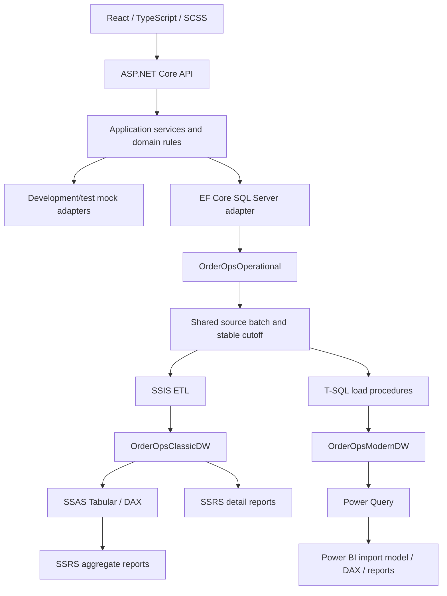

# OrderOps Design

## Goals and Scope

Build a small modular monolith, beginning with a SQL-independent .NET API. Add real SQL Server persistence, independently implement equivalent classic and modern BI pipelines, then complete a responsive React workflow.

The first version supports products, customers, stock adjustments, draft orders, confirmation, cancellation, and filtered lists. Exclude real payments, shipping providers, multi-tenancy, microservices, and custom identity infrastructure. Authentication, background processing, historical dimensions, and cloud hosting are separate stretch tasks.

## Architecture



One SQL Server instance hosts the three domain databases. SSISDB and SSRS catalog databases are additional service databases. The API writes only to the operational database. Each warehouse owns its staging, audit, reject, and watermark state; neither warehouse depends on the other.

Power BI is an analytics/reporting platform, not a replacement SQL standard or transactional database. Both warehouses start with equivalent relational structures, making ETL, modeling, reporting, and deployment the comparison variables.

## .NET Learning Surface

- ASP.NET Core controllers, DTOs, REST status codes, OpenAPI, validation, filtering, sorting, and pagination.
- Dependency inversion through domain-specific ports such as `IOrderStore` and `IProductCatalog`; avoid a generic repository added solely for practice.
- Dependency injection lifetimes, middleware order, ProblemDetails, correlation IDs, structured logging, configuration, health checks, and restricted CORS.
- EF Core SQL Server, versioned migrations, server-translated LINQ, indexes, transactions, and optimistic concurrency.
- Asynchronous I/O and cancellation; later a bounded background job. Async is not synonymous with multithreading, and concurrent tasks must not share a DbContext.

Mock adapters are explicitly Development/Test-only and fail configuration outside those environments. Real integration runs must never silently fall back to mocks.

## Domain Rules to Finalize in Task 0.4

Use decimal money in one documented currency and UTC operational timestamps. Preserve order history; reporting excludes cancelled sales. Freeze sale-time unit prices and costs so later catalog edits do not rewrite historical margins.

Confirmation and stock consumption must be atomic. Use version tokens for conflicting updates and test two competing stock claims. Define repeated confirmation/cancellation behavior and the stock-return policy before implementation. Decide whether draft orders reserve stock; the recommended starting rule is that they do not.

EF migrations are the schema authority for operational tables. Warehouse database projects/scripts own warehouse schemas; do not maintain a second competing operational schema definition.

## Parallel BI Contract

| Concern | Classic track | Modern track |
| --- | --- | --- |
| Warehouse | `OrderOpsClassicDW` | `OrderOpsModernDW` |
| ETL | SSIS initial and incremental loads | Versioned T-SQL initial and incremental loads |
| Scheduling | SQL Server Agent | SQL Server Agent |
| Semantic model | SSAS Tabular | Power BI import semantic model |
| Measures | DAX | Equivalent DAX semantics |
| Reporting | Parameterized, paginated SSRS RDL | Interactive Power BI Desktop reports |

Power Query ingests and shapes model data; it does not write the operational database or replace transactional warehouse load procedures. Begin with manual Power BI Desktop refresh. Scheduled warehouse loads do not imply unattended Desktop model refresh.

### Grain and Metrics

Start with `FactSales` at one confirmed order line, related to `DimDate`, `DimProduct`, and `DimCustomer`. Use Type 1 dimensions initially. Define net revenue, gross profit, units, cancellation treatment, report calendar, and date/category filters identically. Inventory snapshots and Type 2 history are deferred.

Start with a small fixture whose expected totals can be calculated independently. Later generate seeded synthetic twelve-month data, approximately 50,000 order lines adjusted to hardware. Include bad rows, late changes, and cancellations. Commit the generator/seed and small fixtures, not large generated datasets.

### Loads and Reconciliation

Use the same immutable source batch ID and cutoff for both tracks, not unrelated reads of a changing live source. Choose a safe committed-change capture strategy in task 2.4; do not assume an increasing ID alone guarantees commit order or that a timestamp watermark cannot miss concurrent updates.

Advance each track's watermark only after its load commits successfully. Stable business keys prevent duplicate facts on reruns. Handle inserts, updates, cancellations, rejects, and restart after a failure. Compare warehouse rows and SQL/DAX aggregates to independent golden results, then compare both tracks at the same cutoff.

Report monthly revenue, gross profit, and category sales, including a freshness indicator. Compare refresh latency, resource use, deployment steps, and maintainability as well as visual appearance.

## Tools and Machine Gate

Use .NET 10 LTS with a matching EF Core major version and Visual Studio Community 2026 subject to current supported SDK/extension checks. Use SQL Server 2022 Developer for development/testing, SSMS, SSDT and separate SSIS/SSAS/SSRS project extensions, SSIS runtime/catalog, SSAS Tabular server, and a separate SSRS 2022 installation.

SQL Server is the appropriate choice because SSIS, SSAS, and SSRS are Microsoft-native learning goals. Oracle is useful elsewhere but adds tooling/integration work without advancing this scope. SQL Server Express/LocalDB are not substitutes for the full BI stack.

SQL Server 2025 consolidates newer on-premises reporting under Power BI Report Server; SSRS 2022 remains supported. Standard Power BI Desktop works with SQL Server 2022 and is free for local authoring. Power BI Report Server is a separate optional migration/hosting exercise with matching Desktop and licensing requirements. Service sharing may require paid licenses/capacity and an organizational account; private SQL refresh needs a gateway.

**Do not install on the current machine.** On the intended Windows host, confirm its identity, OS, CPU architecture, RAM, free disk, admin access, existing tools, and account restrictions. A practical combined-stack budget is 32 GB RAM and 80-100 GB free disk, not a vendor minimum; 16 GB may require staged services and memory caps. Check current vendor requirements before approving installs.

If layers run on different machines, use trusted LAN/VPN connections, encrypted SQL connections, least-privilege identities, and narrow firewall rules. Never expose SQL publicly or commit credentials. Handle any elevation prompts directly on the host.

For React use supported Node LTS, TypeScript, Vite, Sass, ESLint, and Prettier. VS Code extensions: ESLint and Prettier; optionally Stylelint with SCSS configuration and Microsoft MSSQL. C# Dev Kit is optional if using VS Code for .NET; Visual Studio is the primary recommendation.

## Isolation and Integration

| Slice | Isolation | Required real integration |
| --- | --- | --- |
| Domain/application | Deterministic fake ports and xUnit | SQL transactions/concurrency once adapter exists |
| API | WebApplicationFactory with mock adapters | Same behavior against isolated SQL Server |
| React | MSW matching shared contract; Vitest/Testing Library | Playwright against real API and SQL |
| BI | Small fixture databases with known expected aggregates | Real SSIS, SSAS, SSRS, Power Query and Power BI execution |

EF InMemory or SQLite cannot validate SQL Server translation, locking, or rowversion behavior. BI isolation means small controlled datasets, not mock implementations of the BI engines. MSW must reject unhandled requests and cover failure/empty/conflict responses.

The final workflow creates a product, customer, and order through React, confirms it, checks stock and database state, cancels a separate order, loads both warehouses, refreshes both models, and verifies report metrics at the same cutoff. Playwright checks browser workflows; SQL/DAX tools and manual report checks validate desktop/server BI. Also check mobile/desktop layouts, accessibility, outages, and stale data indicators.

## Directory Structure

The layer roots exist through tracked ignore files. Nested source directories below are planned and will be created only in their authorized tasks; no empty application projects are generated now.

```text
4_fullstack/
  README.md
  .gitignore
  design/
    DESIGN.md
    todo/index.md
    todo/phase_0/ ... phase_3/ ... stretch/
  dotnet/
    .gitignore
    OrderOps.slnx (or generated supported solution format)
    src/OrderOps.Api/ ... Application/ ... Domain/ ... Infrastructure/
    tests/OrderOps.UnitTests/ ... OrderOps.ApiTests/
  sql/
    .gitignore
    operational/
    classic/database/ ... ssis/ ... ssas/ ... ssrs/
    modern/database/ ... loads/ ... powerbi/
    tests/
  react/
    .gitignore
    src/ (colocated tests and mocks/)
    public/
  shared/
    .gitignore
    contracts/
    fixtures/
  tests/
    .gitignore
    integration/
  scripts/
    .gitignore
```

Keep npm lockfiles, contracts, schemas/load scripts, SSIS/SSAS/SSRS source artifacts, sanitized Power BI project/model/report definitions, safe configuration examples, and small expected-result fixtures. Exclude secrets, caches, build/deploy outputs, database files/backups, exports, and large generated data. Prefer source-friendly Power BI projects where supported; sanitize any committed PBIX and control binary size.

## Cloud and Reference Projects

After the local integration milestone, consider Azure API hosting, an Azure SQL copy, CI/CD, secret management, and a Power BI service gateway where required. Approve accounts, licenses, budget limits, and teardown procedures before provisioning. Fabric pipelines/warehouse are a later comparison, not part of this first modern track.

Codespaces is useful for React, .NET, and mocks, but not a replacement for the Windows BI workstation. A remote Windows environment is another option with explicit cost and support checks.

[dotnet/eShop](https://github.com/dotnet/eShop) is an optional open-source architecture reference, not the project scaffold. This learning project deliberately avoids adopting a larger distributed application.

## References

- [.NET support policy](https://dotnet.microsoft.com/en-us/platform/support/policy/dotnet-core)
- [SSDT and separate BI extensions](https://learn.microsoft.com/en-us/sql/ssdt/download-sql-server-data-tools-ssdt)
- [Reporting Services consolidation FAQ](https://learn.microsoft.com/en-us/sql/reporting-services/reporting-services-consolidation-faq)
- [Power BI Desktop](https://learn.microsoft.com/en-us/power-bi/fundamentals/desktop-get-the-desktop)
- [On-premises gateway](https://learn.microsoft.com/en-us/power-bi/connect-data/service-gateway-onprem)

Recheck version compatibility and licensing at installation time. The [TODO index](todo/index.md) is the single task-status record; the learner controls acceptance and completion.
